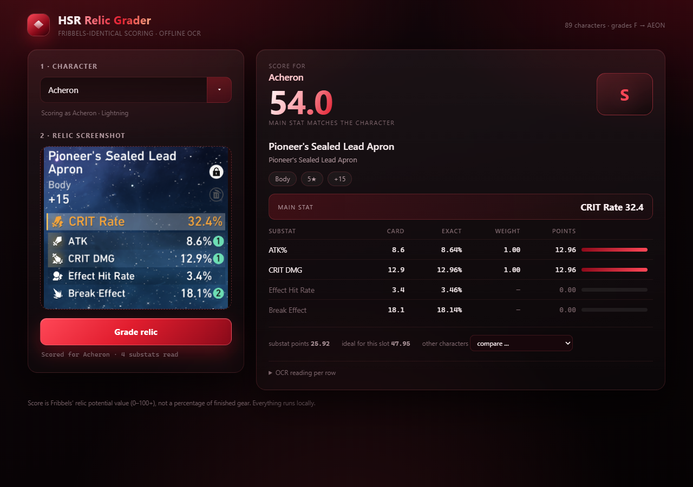

# HSR Relic Grader (Fribbels-exact)

Grades a Star Rail relic for any character, using **the same stat weights and the
same maths as [Fribbels HSR Optimizer](https://fribbels.github.io/hsr-optimizer/)**.
Reads the relic off a screenshot with Tesseract OCR. Everything runs locally; no
account, no internet.

**Quick start (Windows):** double-click **`run_ui.bat`**, pick a character, then paste or
drag the relic screenshot in. For the command line use **`run.bat`**.

One prerequisite, because Tesseract is ~240 MB of binaries and is deliberately not in
this repo:

```bat
python tools\install_tesseract.py     :: downloads and unpacks it into vendor\
```

```
Relic : Pioneer's Sealed Lead Apron
Set   : Pioneer Diver of Dead Waters
Slot  : Body   5*   +15
Main  : CRIT Rate 32.4%
Subs  : ATK% 8.6, CRIT DMG 12.9, Effect Hit Rate 3.4, Break Effect 18.1

Acheron: 54.0   (S)
```

The number is Fribbels' relic potential *value* (not a percentage of finished
gear) - the same number the site shows next to the letter grade.

## Three ways to run it

| | what | launch |
|---|---|---|
| **Desktop UI** (recommended) | character dropdown, paste/drop/upload a screenshot, score + breakdown | double-click **`run_ui.bat`** |
| **Discord bot** | `!grade` → pick a character → upload the screenshot → graded embed | its own repo: **hsr-relic-grader-bot** |
| **CLI** | scriptable, one shot or a table vs. every character | **`run.bat`** or `main.py` (below) |

Both the UI and the bot OCR and grade locally: the screenshot never leaves your PC.

## UI



Pick a character (searchable, alphabetical, 89 entries), then paste with **Ctrl+V**,
drag the image in, or click the drop zone to browse. The result shows the score, the
letter grade, the parsed relic, and a per-substat table with the card value, the
roll-exact value Fribbels actually scores, the character's weight and the points it
earned. "other characters" re-scores the same relic for anyone else without re-reading
the image.

## CLI

```bat
run.bat
```
then type a character and paste/drag the screenshot path. Or non-interactive:

```bat
.venv\Scripts\python.exe main.py -c Acheron -i "C:\path\shot.png"
.venv\Scripts\python.exe main.py -c Acheron -i shot.png --all     :: score vs every character
.venv\Scripts\python.exe main.py -i shot.png --all                :: no character needed
.venv\Scripts\python.exe main.py --list                           :: known characters
.venv\Scripts\python.exe main.py -c Acheron -i shot.png --debug    :: show raw OCR rows
.venv\Scripts\python.exe main.py -c Acheron -i shot.png --raw      :: score displayed values as-is
```

Character lookup is fuzzy: `acheron`, `Acheron`, `dan heng imbibitor`, ids like `1308` all work.

## How the score is computed

Ported 1:1 from `fribbels/hsr-optimizer`, `src/lib/relics/scoring/` (`currentScore.ts`,
`optimalScore.ts`, `scoringMetadata.ts`, `substatScoring.ts`, `scoreFormatting.ts`):

```
potentialScale(stat) = 6.48 / grade5_high_roll(stat)      CD/BE 1.0, DEF% 1.2,
                                                          HP%/ATK%/EHR/RES 1.5, CR 2.0, SPD 2.49
raw   = Σ  value(stat) × weight(stat) × potentialScale(stat)
ideal = 6.48 × (6 × w1 + w2 + w3 + w4)     # top 4 remaining weights, main stat excluded
pct   = truncate10ths(round5(raw / ideal × 100))
grade = F / F+ / D / D+ … S (50) / S+ (55) / SS / SS+ / SSS … AEON (90)
```

Details that are easy to get wrong and are handled here:

* **Flat HP/ATK/DEF weights are 40% of their `%` counterpart's weight** (`applyFlatStatScaling`), and flat stats are scored with their own high roll.
* **If the main stat is one of the weighted substats** (e.g. CRIT Rate body on Acheron) the ideal is recomputed without it — that's why a great crit body can score above 50% but never looks like a 100% roll.
* **`flatMainstatBoost`** characters (Blade HP, Robin ATK, Aventurine DEF …) get the boosted flat substat scored at the `%` weight on relics whose main stat is that `%` stat.
* **Wrong main stat ⇒ grade `?`** (Head/Hands exempt), exactly like the site.
* **Displayed values are truncated by the game** (12.9 is really 12.96). Fribbels imports the true values, so the OCR path snaps each displayed substat back onto a real combination of roll values (`low/mid/high` per stat) before scoring. `--raw` disables that.
* Grade-5 relic check, `AEON` only for aeon-eligible weight sets, all 5 rating tiers per 5%.

Weights come from every character config in the optimizer (`src/lib/conditionals/character/**`,
109 characters/entries) and live in `relic_grades/data/weights.json`.

## OCR

`relic_grades/ocr.py`:

1. Text mask = bright pixels minus the green roll-count badges.
2. Rows found by horizontal projection of that mask.
3. Each row is split at its widest column gap: left = stat name, right = value.
   Values are read with several preprocessing passes (tight crop, 110/130 binarise,
   raw grey, 4× upscale) and the readings are voted — a candidate that snaps onto a
   real roll total wins, which kills `12.9 → 292.9 / 2.9` style misreads.
4. Stat / slot / piece names are fuzzy-matched (`CRITDMG → CRIT DMG`,
   `EffectHitRate → Effect Hit Rate`, `Pjoneer's Sealed Lead Apron → Pioneer's Sealed
   Lead Apron`), so the slot and the set come from the piece table even when the
   "Body" line is faint.
5. The item level (`+15`) and the relic grade are recovered too — grade is inferred
   from the main stat value (32.4 ⇒ 5★, 21.57 ⇒ 4★ …).

## Data files

| file | what |
|---|---|
| `relic_grades/data/weights.json` | per-character substat weights, parts, flatMainstatBoost (from the optimizer source) |
| `relic_grades/data/relic_pieces.json` | piece name → set + slot (Mar-7th/StarRailRes game data) |
| `relic_grades/data/main_stats_max.json` | max main stat per stat per relic grade |
| `relic_grades/data/relics_min.json` | relic id → set, slot, rarity (for showcase lookups) |

These ship *inside* the package, so `pip install` carries them along.

Regenerate:

```bat
python tools/extract_weights.py C:\path\to\hsr-optimizer
python tools/extract_main_stats.py C:\path\to\hsr-optimizer
python tools/build_piece_table.py
```

## Sample screenshots

`samples/` holds the three screenshots this was built and tested against:

| file | relic | scored for | result |
|---|---|---|---|
| `acheron_pioneer_body.png` | Pioneer's Sealed Lead Apron (Body) | Acheron | 54.0 (S) |
| `boothill_eagle_feet.png` | Eagle's Quilted Puttees (Feet, SPD main) | Boothill | 63.3 (SS) |
| `dahlia_ironcavalry_body.png` | Iron Cavalry's Silvery Armor (Body, HP% main) | The Dahlia | 50.0 (S) |

## Tests

```bat
.venv\Scripts\python.exe tests\test_scoring.py
.venv\Scripts\python.exe tests\test_ocr.py        :: runs the real screenshot through OCR
```
The reference case is the Acheron screenshot (Pioneer body, CR 32.4% main, ATK% 8.6 /
CD 12.9 / EHR 3.4 / BE 18.1) → **54.0 (S)**, which is what the site shows for it.

## Layout

```
main.py                          CLI
run_ui.bat / run.bat             clickable launchers
pyproject.toml                   packaging: pip install hsr-relic-grader
relic_grades/fribbels.py         scoring engine (constants, formulas, tiers, roll snapping)
relic_grades/characters.py       character table + lookup
relic_grades/ocr.py              screenshot -> relic (Tesseract pipeline)
relic_grades/grade.py            image|relic + character -> grade payload
relic_grades/showcase.py         UID showcase lookup (api.mihomo.me)
relic_grades/paths.py            where the data tables and Tesseract are looked up
relic_grades/tesseract_setup.py  portable Tesseract downloader
relic_grades/data/               weights + tables (shipped inside the package)
ui/app.py                        local web server (stdlib only) for the UI
ui/static/                       the UI itself (html/css/js)
tools/                           data extraction scripts
vendor/tesseract/                portable Tesseract 5.4 - not in the repo, see above
```

## Install as a package

```bat
pip install git+https://github.com/RealSuperSlime/hsr-relic-grader
hsr-relic-grader-tesseract          :: fetch Tesseract once, into %LOCALAPPDATA%
```

```python
from relic_grades.grade import grade_image

result = grade_image("relic.png", "Acheron")
print(result["score"])              # {'value': 54.0, 'grade': 'S', 'ideal': ..., ...}
```

The data tables travel inside the package. If you already have Tesseract, point
`RELIC_TESSERACT` at its `tesseract.exe` instead of running the downloader.

## Licence and credits

**AGPL-3.0-or-later** — see `LICENSE`. That licence is inherited, not chosen: the game
data tables in `relic_grades/data/` come from
[Mar-7th/StarRailRes](https://github.com/Mar-7th/StarRailRes) (AGPL-3.0). The scoring
engine is a port of [Fribbels HSR Optimizer](https://github.com/fribbels/hsr-optimizer)
(MIT). `CREDITS.md` lists exactly what came from where.

`.gitignore` keeps the bulky and the private out of the repo: `vendor/` (~240 MB of
Tesseract binaries), `.venv/`, build artefacts and caches.
